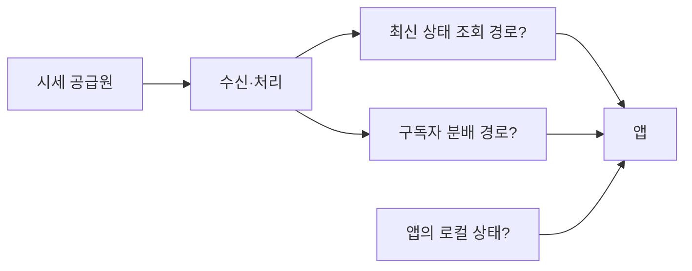

# 토스증권·한국투자증권 서버 아키텍처 추론 케이스 스터디

작성·공개 자료 확인: 2026-10-27. 상태: **공개 자료 조사와 연구 설계 완료, 새 단말 실험 미실시.**

목표는 두 회사의 시세 시스템에 대해 스스로 후보 구조를 만들고, 공개 사실과 관측으로 후보를 평가하는 것이다. 최종 질문은 **“종목 상세의 최초 가격 표시와 이후 시세 갱신을 어떤 구조가 설명하며, 그 구조는 부하·장애·느린 연결을 어떻게 처리할까?”**다. 실제 운영 구조와 속도 차이의 원인은 아직 미확정이다.

## 1. 기존 접근이 막힌 원인과 수정 방향

| 기존 접근의 문제 | 왜 질문에 답하기 어려운가 | 이번 연구의 수정 |
|---|---|---|
| 화면 완료 시간으로 서버를 설명하려 했다 | 화면에는 네트워크·서버·캐시·렌더링과 작업 중첩이 함께 반영된다 | 최초 표시, 지속 갱신, 재접속을 나눠 관측한다 |
| “망이 느리다”와 “망을 사용하는 구조”를 묶었다 | 외부 RTT, 서버 내부 전달 지연, 송신 용량은 서로 다른 변수다 | 구간마다 원인 후보와 필요한 증거를 적는다 |
| 도구 구현이 실제 증거를 대신했다 | 도구는 있지만 두 앱의 RTT 주입·패킷 캡처 실측은 아직 없다 | 구현 상태와 관측 결과를 별도로 기록한다 |
| Open API를 모바일 앱의 대리 자료로 쓸 위험이 있었다 | 같은 회사라도 제품 경로·인증·전달 방식이 다를 수 있다 | 회사·제품·발표 시점·관측 세션을 모든 주장에 붙인다 |
| 자체 대용량 서버 구현으로 주제가 이동했다 | 사용자가 알고 싶은 것은 두 회사 구조를 추론하는 과정이다 | 공개 자료 → 경쟁 구조 → 관측 → 설계 판단을 주 경로로 삼는다 |

예비 촬영은 종목·키보드 상태가 다른 두 조건에 각 1페어다. 삼성전자에서는 토스−한국투자 차이가 +652.789ms, SK하이닉스에서는 +36.577ms였다. 반복성과 원인을 평가할 표본이 아니며, 네트워크 문제라는 결론도 아직 없다. 근거: [예비 측정 원문](PILOT_RESULT_20261015.md).

## 2. 근거를 기록하는 규칙

- **P — 공개 사실:** 해당 회사가 특정 시점·제품에 대해 직접 밝힌 내용.
- **O — 직접 관측:** 이 프로젝트에서 기기·앱 버전·조건을 기록하고 확인한 동작.
- **H — 가설:** P/O를 설명하는 후보 구조. 대안과 틀릴 수 있는 조건을 함께 적는다.
- **D — 내 설계:** 같은 요구를 내가 구현한다면 선택할 구조와 그 이유.
- **U — 미확인:** 현재 증거로 식별할 수 없는 항목.

예: `P: 2022년 발표에 WebSocket 경로가 있다`와 `H: 현재 최초 가격도 그 스트림으로 받는다`는 서로 다른 주장이다. 그림의 각 선에도 P/O/H/U와 근거 ID를 붙인다. 공개 여부와 자료의 자세함을 시스템의 우수성으로 해석하지 않는다.

## 3. 출발점이 되는 1차 근거

PDF 페이지는 표지부터 센 1기준이다. 자료를 통째로 재게시하지 않고 원문 링크와 짧은 요약을 보관한다.

| ID | 출처·시점·범위 | 확인한 사실 | 이 사실로 확정할 수 없는 것 |
|---|---|---|---|
| E01 | [SLASH22 박성우 「실시간 시세 적용기」](https://static.toss.im/assets/homepage/slash22/pt-session/SLASH22_%EB%B0%95%EC%84%B1%EC%9A%B0%EB%8B%98.pdf), 2022, pp.9·12 | 당시 시세 Gateway의 HTTP API와 Realtime의 WebSocket, 접속 서버 라우팅과 종목별 구독을 소개 | 현재 화면의 최초 가격 경로, 모든 화면의 프로토콜 |
| E02 | [SLASH23 정도원 「실시간 시세 데이터 안전하고 빠르게 처리하기」](https://toss.im/slash-23/session-detail/B1-7), 2023. [발표 PDF](https://static.toss.im/assets/homepage/slash23/pt-session/slash23-1-2-5-jdw.pdf), pp.8·21·44 | 시세 수신·처리 구조와 최적화 과정을 소개. 발표 내 Kafka/Redis Pub/Sub 비교에 15ms/3ms를 제시 | 앱 화면 전체 응답시간, 보편적 제품 성능비, 전사 Kafka 제거 여부 |
| E03 | [토스증권 Visualize Lineage](https://toss.tech/article/toss-securities-visualize-lineage), 2025-08-11, 도입·실제 사례 | CQRS에 실시간 파이프라인을 활용하며 시세 이벤트가 Kafka와 여러 저장소로 흐르는 사례를 설명 | 모든 시세 API가 그 저장소를 읽는지, 최초 화면의 실제 호출 사슬 |
| E04 | [토스증권 Kafka 데이터센터 이중화 #1](https://toss.tech/article/kafka-distribution-1), 2025-01-08, 서비스 구성·선택 이유 | 두 데이터센터의 서비스가 Active-Active이며, MSA의 Kafka도 이중화 대상으로 설명 | 사용자 한 명의 요청이 어느 센터로 가는지, 이 구성이 화면 차이를 만든다는 인과 |
| E05 | [KIS Open API 서비스 소개](https://apiportal.koreainvestment.com/apiservice-summary), 상시 문서·확인일 기준 | 외부 개발자용 시세 조회와 WebSocket 실시간 시세 인터페이스를 제공 | 한국투자 모바일 앱이 같은 경로를 쓰는지, 내부 서버·캐시 토폴로지 |
| E06 | [한국투자 관심종목 점검 안내](https://securities.koreainvestment.com/main/customer/notice/Notice.jsp?cmd=TF04ga000002&num=46150), 게시 2026-02-06·점검 02-07 | 서버 증설 중 MTS·HTS·웹의 관심종목 변경 제한, 기존 목록 조회 가능 | 독립 서비스·CQRS·읽기 복제·Redis 사용 여부 |
| E07 | [공식 Open API 예제](https://github.com/koreainvestment/open-trading-api), 확인일 기준 | 외부 API 연동용 클라이언트 예제를 제공 | 서버 구현이나 MTS 소스 |

조사 범위는 토스 공식 발표·기술 블로그, 한국투자 공식 API 자료·샘플·운영 공지다. 이 범위에서는 한국투자 MTS 시세의 상세 토폴로지를 확인하지 못했다. 이를 “공개 자료가 전혀 없다” 또는 “구조가 단순하다”는 결론으로 확대하지 않는다.

구조 초안에서는 아래처럼 확인 수준을 비교한다. 서로 다른 연도의 토스 자료를 합쳐 현재 운영 구성도라고 표시하지 않는다.

| 부분 | 토스증권의 공개 기준점 | 한국투자증권의 공개 기준점 |
|---|---|---|
| 시세 수신·내부 처리 | 수신부·처리부와 조회/메시지 전달 경로(E02, 2023) | 이번 조사에서 MTS 경로 미확인(U) |
| 사용자 조회·종목 구독 | HTTP API·WebSocket 경로와 접속 라우팅(E01, 2022) | Open API의 두 인터페이스는 확인(E05), MTS 경로는 U |
| 데이터 파이프라인·센터 장애 | 실시간 파이프라인과 데이터센터 이중화(E03·E04, 2025) | 이번 자료로 세부 구조 U |
| 여러 채널의 기능 영향 범위 | 이 표의 자료로 직접 비교하지 않음 | 관심종목 변경 제한·조회 유지 공지(E06, 2026) |

## 4. 케이스 A: 토스의 시세 내부 처리 최적화

**질문:** 화면이 늦을 때 어느 구간부터 원인을 좁혀야 할까?

E02는 회사가 공개한 실제 개선 사례다. pp.21·44의 비교는 내부 시세 처리 맥락의 결과이며, 모바일의 `탭→가격 표시`와 측정 범위가 다르다. 하드웨어·부하·측정 경계가 모두 같다는 정보가 없으므로 수치를 우리 앱 측정에 직접 대입하지 않는다.

학습 순서:

1. p.8의 수신·처리 경계를 보고 “어디서 시각을 찍어야 구간 지연을 구할 수 있을까?”를 먼저 그린다.
2. p.21을 보고 “메시지 전달 경로를 바꾸면 무엇이 빨라지고, 장애 때 무엇을 잃을 수 있을까?”를 적는다.
3. p.44에서 전달 경로 변경과 처리부 최적화를 구분한다. 여러 변경을 한꺼번에 하나의 원인으로 묶지 않는다.
4. E03·E04와 비교한다. 2023년 한 처리 경로의 선택과 2025년 다른 파이프라인의 Kafka 활용은 공존할 수 있다.

**설계 이유에 대한 내 해석(H/D):** 데이터의 최신성·재처리 필요성·장애 복구 요구가 다르면, 낮은 지연의 전달 경로와 보존 가능한 이벤트 경로를 다르게 설계할 수 있다. Redis Pub/Sub은 미접속 구독자의 누락 메시지를 재전송하지 않는다. 따라서 어떤 데이터를 어디서 복구하는지를 함께 질문해야 한다. 근거: [Redis 전달 의미 공식 문서](https://redis.io/docs/latest/develop/pubsub/#delivery-semantics). 이것이 토스의 복구 구현을 확정하는 근거는 아니다.

**우리 연구에 적용:** 외부 화면 측정은 전체 경로의 끝만 본다. 서버 내부 구간의 원인은 공개된 계측 사례에서 학습하고, 현재 앱과 연결되는 부분은 H/U로 남긴다. “Kafka보다 Redis가 항상 빠르다”나 “토스 앱은 이 변경 때문에 빠르다”로 결론 내리지 않는다.

## 5. 케이스 B: 한국투자에서 조회와 변경의 가용성이 달랐던 점검

**공개 사실(P):** E06의 관심종목 점검은 여러 온라인 채널의 변경 업무를 제한하면서 기존 목록 조회는 허용한다고 안내했다.

| 후보 | 같은 공지를 설명하는 구조 | 필요한 추가 증거 |
|---|---|---|
| H-K1 | 같은 서비스에서 점검 중 변경 요청만 차단 | 회사의 운영 설명·내부 요청 처리 정보 |
| H-K2 | 조회는 캐시/복제 데이터, 변경은 원본 저장소 경로 | 읽기 데이터의 갱신·일관성 정책에 대한 공개 자료 |
| H-K3 | 읽기 모델과 변경 모델을 분리 | 회사가 공개한 논리 구성도와 데이터 동기화 설명 |

세 후보는 현재 공지와 모두 양립한다. 외부에서는 계정의 관심종목이 앱·웹 사이에 반영되는 양상을 정상 사용으로 관찰할 수 있지만, 이것만으로 저장소 종류나 물리 서버 분리를 식별하기는 어렵다.

**설계 이유에 대한 내 해석(H/D):** 변경 경로의 작업 중에도 읽기 가용성을 유지하면 영향 범위를 줄일 수 있다. 이 장점을 읽기 모델 분리의 후보 이유로 적되, 실제 회사의 선택으로 단정하지 않는다. 이 사례는 모바일 종목 상세의 속도 원인과도 별도다.

## 6. 내가 먼저 그릴 현재 앱의 경쟁 구조

두 앱에 각각 아래 후보를 그린다. 토스의 E01은 H1의 출발 근거지만, 현재 상세 화면이 H1이라는 확인은 아니다. 한국투자에는 E05를 MTS 증거로 대입하지 않는다.

| 후보 | 최초 가격이 나오는 경로 | 이후 갱신 | 관측으로 확인하고 싶은 예측 |
|---|---|---|---|
| H1: 조회·구독 분리 | 조회 API로 현재 값 수신 | 지속 연결의 구독 데이터 | 최초 표시와 구독 준비가 독립적이거나 겹치는가? |
| H2: 구독 시 현재 값 제공 | 구독 응답의 초기 상태 또는 첫 이벤트 | 같은 연결의 후속 데이터 | 최초 표시가 연결/구독 준비와 함께 움직이는가? |
| H3: 로컬 값 먼저 표시 | 로컬에 이미 받은 값 표시 | 백그라운드로 갱신 | 통신 불가 상태에서도 이전 값이 표시되는가? |

H3는 H1/H2 앞에 결합될 수 있다. 후보를 무조건 하나만 고르는 방식으로 평가하지 않는다. HTTP API가 있어도 최초 가격이 그 API에서 온다고 확정하지 않는다.

아래는 **특정 회사의 실제 구성도가 아닌 질문용 뼈대**다. 각 상자·선을 P/H/U로 표시하며 그린다.

초안에 반드시 답할 질문은 다섯 가지다. 가격 최초 표시에 필요한 데이터는 무엇인가? 조회와 갱신을 분리할 이유는 무엇인가? 한 종목의 업데이트를 누가 여러 연결에 복사하는가? 연결이 끊겼을 때 무엇을 다시 요청하는가? 실제로 확인한 선은 어디까지인가?

## 7. 4주 로드맵과 완료 기준

기간은 학습 배치의 예시이며, 장비 준비와 장중 측정 가능 시간에 맞춰 조정한다.

| 단계 | 내가 할 일 | 이 순서인 이유 | 완료 기준 |
|---|---|---|---|
| 1주: 질문과 공개 구조 | E01·E02·E05를 읽기 전에 각 앱 구조 초안을 그린 뒤, 자료를 읽고 선마다 P/H/U를 붙인다. 최초 가격·지속 갱신·복구를 별도 시퀀스로 그린다 | 기술 이름을 먼저 고르면 관측을 거기에 맞추기 쉽다 | 회사별 초안, 근거 대장, 경쟁 가설 3개와 반증 조건 |
| 2주: 작은 단말 예비 실험 | 같은 종목 재진입/다른 종목 진입, 프로세스 재시작, 통신 불가 상태의 표시를 살핀다. 여건이 되면 앱별 비복호화 캡처를 별도 세션에서 수행 | RTT 장비를 꾸미기 전에 더 저렴한 관측으로 후보를 줄인다 | 촬영·판독 기준 고정, 재현 가능한 조건 1개 선정. 소수 관측은 경향 탐색으로만 기록 |
| 3주: 구분력 있는 반복 실험 | 선정 조건에서 순서를 교대해 반복한다. 지연 주입 보정이 통과하면 기존 64회 RTT 계획을 사용한다. 통과하지 못하면 망별 관측만 하고 인과 비교를 보류한다 | 실제로 후보 예측이 갈리는 조작에 시간을 쓴다 | 단계별 완료·실패 수, 화면 지연, RTT 민감도와 불확실성, 가설별 갱신 기록 |
| 4주: 구조 수정과 설계 판단 | E03·E04·E06을 포함해 수정 구조 v1을 만들고, 부하/장애 때 필요한 관측과 내 개선안을 적는다 | 한 기기의 결과와 전체 시스템 용량을 구분하면서 대용량 설계로 확장한다 | 회사별 근거 지도, 살아남은 대안, 설계 선택의 이점·비용, 미확인 항목 |

## 8. 관측별 판정 기준

| 실험 | 고정·조작 | 지지할 수 있는 해석 | 남는 대안·주의 |
|---|---|---|---|
| 같은 종목/다른 종목 재진입 | 기기·망·화면 시작 상태 고정, 방문 이력과 간격 조작 | 종목별 상태 또는 앱 전체 준비 상태의 영향 | 로컬/서버 캐시·미리 받기·연결 재사용을 하나로 확정 못 함 |
| 통신 불가 표시 | 준비 상태와 차단 시점을 기록, 이전/이번 세션 새 종목 비교 | 표시 가능한 데이터가 이미 로컬에 존재할 가능성 | 로컬 캐시와 사전 수신을 단독으로 구분 못 함. 안 보인다고 캐시 부재도 확정 못 함 |
| 지연 단계별 최초 표시 | 보정된 동일 공유 경로, 앱 순서 교대, 같은 완료 기준 | 화면 완료의 RTT 민감도 차이 | k는 정확한 API 수·왕복 수·서버 내부 hop 수가 아님 |
| 연결·데이터 시각 | 앱 필터, 탭 시각, 배경 동작, 캡처 조건 기록 | 새 연결/재사용·수신 패턴 후보 | 암호화 데이터 묶음은 특정 API/시세/서버 처리시간을 식별하지 못 함 |
| 지속 갱신·복귀 | 같은 거래소·시세 종류·종목·시장 단계, 관찰 길이 고정 | 갱신의 관측 간격, 복귀 후 표시 회복 양상 | 가격이 같으면 이벤트가 와도 화면은 안 바뀔 수 있음. 화면 갱신 간격은 전송 주기가 아님 |

시세 종류는 KRX/NXT/통합 시세 등 앱에 표시된 기준을 기록한다. 같게 맞추지 못하면 별도 조건이다. 화면 최초 가격이 최신 체결이라는 가정도 두지 않는다. 서버의 발행 시각·순번 같은 기준이 없으면 가격 최신성의 절대 지연은 미확인이다.

기존 `observations`의 `elapsed_ms`는 고정한 화면 완료 기준에만 쓴다. 지속 갱신·복귀 관측을 같은 지연 값으로 섞지 않고 별도 비공개 대장에 기록한다. 기존 서버에 지속 시세 계측 기능이 생긴 것은 아니다.

## 9. 대용량 처리 아키텍처로 연결하는 방법

공개 자료에서 확인한 문제를 출발점으로 삼는다. 토스의 연결 관리·송신 트래픽 사례(E01 pp.15~25), 내부 처리 최적화(E02), 데이터센터 가용성(E04)을 각각 다른 문제로 다룬다. 한국투자에서는 공지로 확인된 기능 영향 범위(E06)를 시작점으로 삼는다.

내가 계산할 부하 모델은 `연결 수`, `종목별 업데이트율`, `종목별 구독자 수`, `전송 크기`다. 모든 이벤트를 개별·비압축 전송한다고 가정한 페이로드 기준량을 `종목별 업데이트율 × 해당 종목 구독자 수 × 메시지 크기`의 합으로 계산한다. 배치·압축·헤더·재전송은 별도 항목이다. **여기에 넣는 수는 설계용 가정이며 두 회사의 실제 규모가 아니다.**

그 모델로 다음 질문을 검토한다. 연결 수로 분산하면 인기 종목의 송신 부하도 균등해지는가? 느린 구독자의 대기량은 어디서 제한하는가? 장애 후 구독 복구가 한꺼번에 몰리면 어떻게 분산하는가? 최신 상태와 누락 없는 이력은 같은 경로여야 하는가?

이 단계의 개선 제안은 D로 표시한다. 타사 서버에 부하를 가하지 않으며, 한 대의 휴대폰 관측으로 서버 최대 처리량·인스턴스 수·오토스케일 정책을 추정하지 않는다. 모의 구현은 특정 가설의 동작을 이해하고 싶을 때 선택하는 보조 실험이다.

## 10. 증거 대장과 최종 결과물

가설 대장에는 `ID / 회사·제품·시점 / 주장 / P·O·H·D·U / 출처·페이지 또는 관측 ID / 대안 / 다음 검증 / 현재 판정`을 기록한다. 판정은 `미평가·양립·지지 증가·지지 감소·보류`로 쓰고, 가짜 확률 점수는 붙이지 않는다.

최종 케이스 스터디는 다음 여섯 항목으로 작성한다.

1. 내가 본 현상과 고정한 완료 기준.
2. 공개 자료로 확인된 구조와 적용 범위.
3. 처음 그린 경쟁 구조와 각 예측.
4. 실제 수행한 관측·조작, 실패·누락을 포함한 결과.
5. 수정 구조와 남아 있는 다른 설명.
6. 내가 설계한다면 바꿀 부분, 기대 효과·비용, 확인에 필요한 지표.

지금의 결론은 **“공개 근거가 있는 부분과 관측으로 구분할 후보를 정했다”**까지다. 다음 첫 작업은 두 앱의 `검색 결과 → 종목 상세 최초 가격 → 지속 갱신` 시퀀스를 각각 그려 H1/H2/H3를 표시하는 것이다. 앱을 사용한 새 실측과 원인 확정은 이후 단계다.
